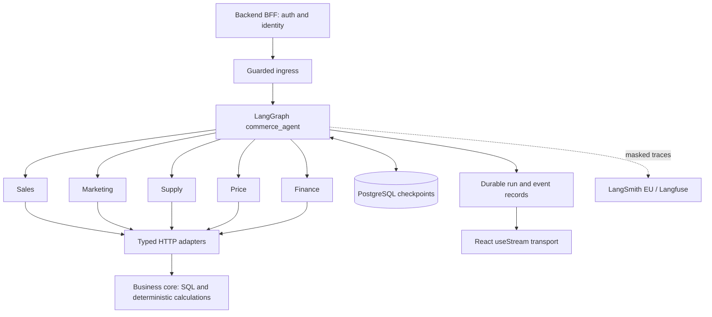

# E-commerce LangGraph Migration

**LangGraph runtime для e-commerce агентов: типизированное состояние, восстановление выполнения и оптимизация контекста модели.**

Отдельный инженерный проект, выделенный из миграции [ecommerce-ai-backend](https://github.com/semenovjenya/ecommerce-ai-backend). Здесь собраны граф, пять доменных subgraphs, HTTP-адаптеры к бизнес-сервисам, checkpoint/protocol слой, проверки изоляции и воспроизводимый benchmark компактного evidence.

**Stack:** Python 3.11 · LangGraph · LangChain · PostgreSQL checkpoints · Pydantic · HTTPX · LangSmith / Langfuse · React `useStream`.

[Оптимизация и измерения](docs/OPTIMIZATION.md) · [Архитектура](docs/ARCHITECTURE.md) · [Проверки и статус](docs/VERIFICATION.md)

## Задача миграции

Исходный backend объединял маршрутизацию, диалог, повторы, межагентные проверки и формирование ответа в собственном runtime. Цель — выразить порядок исполнения и состояние через граф, сохранив финансовые формулы, SQL, согласование и исполнение действий в бизнес-ядре.

Ключевые инженерные задачи:

- Разделить владение результатами Sales, Marketing, Supply, Price и Finance.
- Сохранять типизированное состояние и продолжать вычисления после остановки.
- Проверять identity и входные данные до запуска графа и tracing.
- Ограничивать размер evidence и число исследовательских вызовов.
- Сохранить исходные факты, различая `0`, `null`, отсутствие данных и неподтверждённую гипотезу.
- Разделить публичное состояние, внутренние журналы исследования и секреты подключения.

## Оптимизация

Компактное представление выносит одинаковые поля строк в `shared`, названия полей — в `columns`, а меняющиеся значения — в `rows`. Реализация проверяет точное восстановление исходного evidence до передачи модели.

**Воспроизводимый результат на синтетических данных:**

| Набор | Обычный JSON | Компактный JSON | Уменьшение |
| --- | ---: | ---: | ---: |
| 1 000 строк дневных показателей | 147 132 байта | 35 276 байт | **76,02%** |
| 300 строк вложенного evidence | 51 881 байт | 16 930 байт | **67,37%** |
| Разнородный контрольный набор | 38 байт | 38 байт | 0% |

Все три набора проходят точный roundtrip. Это размер **evidence в UTF-8**, а не измеренная экономия токенов, стоимости или времени ответа. Полный prompt содержит дополнительные инструкции и схему.

```bash
uv run --frozen python -m benchmarks.evidence_payload
```

Другие механизмы: бюджеты исследовательских раундов, запрет повторных завершённых проверок, ссылки на крупные результаты, адресная загрузка evidence и checkpoint resume. Их устройство и ограничения разобраны в [отдельном разделе оптимизации](docs/OPTIMIZATION.md).

## Архитектура



Граф называется `commerce_agent`. Контракт будущего browser-facing BFF — `/v2/agent/*`; внутренний ASGI-сервис требует доверенный серверный контекст. Полного production BFF в этом репозитории нет.

## Запуск за несколько команд

Требуются Python 3.11 и `uv`. Для локальных примеров не нужны ключи провайдеров, БД или доступ к кабинету продавца.

```bash
git clone https://github.com/semenovjenya/ecommerce-langgraph-migration.git
cd ecommerce-langgraph-migration
uv sync --frozen
uv run --frozen python -m examples.checkpoint_demo
uv run --frozen python -m benchmarks.evidence_payload
uv run --frozen python -m pytest
```

`checkpoint_demo` выполняет реальный граф с in-memory checkpointer: останавливается перед `synthesis`, читает checkpoint и продолжает выполнение. В этом примере доменные сервисы не подключены, поэтому результаты доменов имеют `not_implemented`; он демонстрирует orchestration/resume, а не готовый аналитический ответ. Рабочие opt-in реализации находятся в доменных пакетах и подключаются через `*Dependencies`.

## Что смотреть в коде

| Тема | Файл или пакет |
| --- | --- |
| Граф и подключение пяти доменов | [`graph.py`](src/commerce_agent/graph.py) |
| Контракт состояния и reducers | [`state.py`](src/commerce_agent/state.py), [`reducers.py`](src/commerce_agent/reducers.py) |
| Компактное evidence | [`marketing/compact.py`](src/commerce_agent/marketing/compact.py) |
| Бюджет и журнал исследований | [`marketing/research.py`](src/commerce_agent/marketing/research.py), [`research_model.py`](src/commerce_agent/marketing/research_model.py) |
| Проверки HTTP-результатов и больших артефактов | [`adapters/business_tools.py`](src/commerce_agent/adapters/business_tools.py) |
| Checkpoints и совместимость | [`persistence.py`](src/commerce_agent/persistence.py), [`serialization.py`](src/commerce_agent/serialization.py) |
| Isolation и secret rejection | [`ingress.py`](src/commerce_agent/ingress.py), [`safety.py`](src/commerce_agent/safety.py) |
| Protocol events и восстановление worker | [`protocol_store.py`](src/commerce_agent/protocol_store.py), [`protocol_worker.py`](src/commerce_agent/protocol_worker.py) |
| Контракт frontend SDK | [`frontend-probe/`](frontend-probe/) |

## Структура

```text
src/commerce_agent/
  graph.py, state.py, reducers.py
  sales/, marketing/, supply/, price/, finance/
  adapters/                  # Типизированные business APIs
  persistence.py             # PostgreSQL checkpoints
  protocol_*.py              # Commands, events, store, worker
  ingress.py, safety.py       # Identity и защита состояния
  observability.py           # Контролируемый экспорт tracing
examples/                    # Локальный checkpoint demo
benchmarks/                  # Измерение compact evidence + результаты
tests/                       # Автономные проверки
frontend-probe/              # Transport, SDK contract и opt-in live probes
docs/                        # Архитектура, оптимизация, интеграция и статус
```

## Интеграция с backend

[Инструкция подключения](docs/INTEGRATION.md) описывает PostgreSQL, internal service token и HTTP tools. Опубликованный snapshot backend не содержит требуемые маршруты `/internal/v1/agent-tools/*`. Для живой интеграции нужен совместимый business-tools service; эти репозитории не являются готовым комплектом для совместного production-запуска.

## Статус проекта

Это самостоятельный портфолио-экспорт актуального migration runtime. Он не содержит историю исходного Git, ключи, приватные снимки БД или записи клиентских запусков. Для исключённых тестов сохранён [перечень и причины](docs/excluded-private-tests.json).

Завершённость отдельных механизмов подтверждается командами в [отчёте проверки](docs/VERIFICATION.md). Полная migration acceptance, production cutover, общий synthesis/action flow и end-to-end проверка с реальными источниками остаются отдельными этапами. Экспортированный граф сохраняет явные stub-узлы для ещё не завершённых частей; внешние записи через демонстрационный граф отключены.
